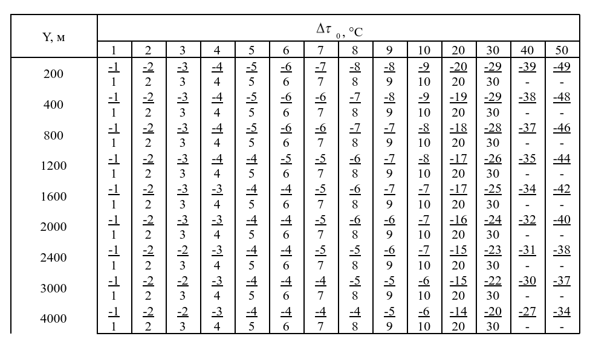

\usepackage{amsmath}

# Алгоритм расчета 
> Учебная модель обработки измерений: названия условные, таблицы используются для упражнений по работе с данными.

Тип оборудования: **Учебный датчик сноса (`УДС`)**

1. `Отклонение наземного давления атмосферы` $ΔH_{0}$ (мм рт. ст.) и отклонение наземной виртуальной температуры воздуха (град) на уровне метеорологического поста. Отклонение наземного давления атмосферы $ΔH_{0}$, записываемое в бюллетень, определяется как разность измеренного давления Н0 и табличного значения наземного давления, равного 750 мм рт. ст., т. е. $ΔН_{0} = Н_{0} – 750$.
Если измеренное давление будет больше 750 мм рт. ст., то отклонение ΔН0 имеет знак «плюс», если меньше – знак «минус».

2. `Отклонение приземной виртуальной температуры` ,  записываемое в бюллетень, определяется как разность между приземной виртуальной температурой, измеренной метеорологическим постом, 
и ее табличным значением, равным **+15,9°С**, т.е.

>
> $ΔT_{0}^{мп}$ = T0  – 15,9
>
>
>Если приземная  виртуальная температура будет больше +15,9°С, 
> от отклонение  имеет знак **«плюс»**, если меньше – знак **«минус»**.
> Приземная виртуальная температура τ0 вычисляется по формуле:
> 
> T0 = t0  + $ΔТ_{V}$
> 
> где:
> - t0 - измеренная приземная температура воздуха. Берется из ячейки > `температура`
> - $ΔТ_{V}$ - виртуальная поправка, определяемая по таблице 1.

**Таблица 1**
|  $t_{0}$ | Ниже 0 | 0 - 5 | 10 - 15 | 20 | 25 | 30 | 40 |
|----------|--------|-------|---------|----|----|----|----|
| $ΔТ_{V}$ | 0      | 0.5   | 1       | 1.5  | 2  | 3.5 | 4.5 |

3. `Средние отклонения температуры воздуха`  $Δt_{Y}$, направление и скорость среднего ветра определяются для стандартных слоев до высоты **4 км**. Среднее отклонение температуры воздуха Y в пределах стандартных высот бюллетеня определяется по **таблице 2**.

**Таблица 2**

> Входами в таблицы являются стандартные высоты бюллетеня Y 
> и отклонение приземной виртуальной температуры.
> 
> **Среднее отклонение температуры** при отрицательных значениях  указано > в числителе дроби, при положительных – в знаменателе дроби.
> 
> Для отклонений $Δt$ между **10 и 20, 20 и 30 и т. д.** среднее отклонение температуры Y определяется путем сложения величины отклонений из столбцов, соответствующих целому числу десятков и числу единиц.

4. `Скорость среднего ветра` $W_{у}$ для всех стандартных высот бюллетеня определяется по **таблице 3**.

**Таблица 3**
Дальность сноса индикатора Дг, м (учебные табличные данные):

| Высота, м | 40 | 50 | 60 | 70 | 80 | 90 | 100 | 110 | 120 | 130 | 140 | 150 | Поправка направления |
|---|---|---|---|---|---|---|---|---|---|---|---|---|---|
| 200 | 3 | 4 | 5 | 6 | 7 | 7 | 8 | 9 | 10 | 11 | 12 | 12 | 0-00 |
| 400 | 4 | 5 | 6 | 7 | 8 | 9 | 10 | 11 | 12 | 13 | 14 | 15 | 1-00 |
| 800 | 4 | 5 | 6 | 7 | 8 | 9 | 10 | 11 | 13 | 14 | 15 | 16 | 2-00 |
| 1200 | 4 | 5 | 7 | 8 | 8 | 9 | 11 | 12 | 13 | 15 | 15 | 16 | 2-00 |
| 1600 | 4 | 6 | 7 | 8 | 9 | 10 | 11 | 13 | 14 | 15 | 17 | 17 | 3-00 |
| 2000 | 4 | 6 | 7 | 8 | 9 | 10 | 11 | 13 | 14 | 16 | 17 | 18 | 3-00 |
| 2400 | 4 | 6 | 8 | 9 | 9 | 10 | 12 | 14 | 15 | 16 | 18 | 19 | 3-00 |
| 3000 | 5 | 6 | 8 | 9 | 10 | 11 | 12 | 14 | 15 | 17 | 18 | 19 | 4-00 |
| 4000 | 5 | 6 | 8 | 9 | 10 | 11 | 12 | 14 | 16 | 18 | 19 | 20 | 4-00 |

> Входами в таблицы являются стандартные высоты  Y и дальности сноса индикатора Дг (м).
> При дальности сноса индикатора `Дг  < 40 м` для всех стандартных высот Y скорость среднего ветра принимается равной нулю. В этом случае в бюллетене для всех стандартных высот Y места цифр, отведенные для направления и скорости ветра, заполняются нулями.

5. `Направление среднего ветра` $α_{WY}$ для всех стандартных высот определяется по формуле: 
$α_{WY} = α_{V0} + Δα_{WY}$

где 
$α_{V0}$ – направление приземного ветра; 
$Δα_{WY}$ – приращение среднего ветра относительно направления приземного ветра, определяемое по **таблице 3**

> Для высот более **4000** метров данные просто копируются из значений на 4000 метров. 
> Для высот менее **200** метров данные просто копируются из значений на 200 метров..

