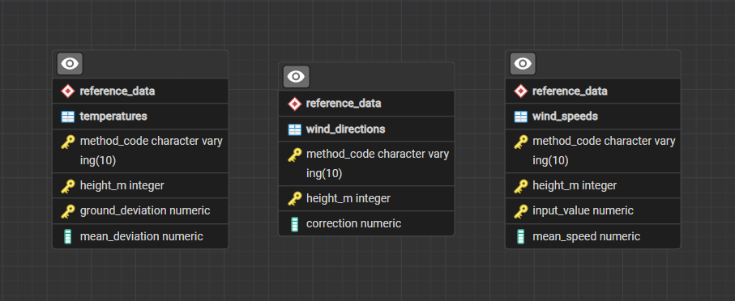

# Проектирование справочников

В схеме reference_data созданы три таблицы без связей:

- temperatures — таблица 2: способ расчёта, высота,
  наземное и среднее отклонения температуры, °C.
- wind_speeds — таблица 3: способ расчёта, высота,
  входное значение и скорость среднего ветра, м/с.
  Вход: дальность сноса для VR, скорость ветра для DMK.
- wind_directions — таблица 3: способ расчёта, высота
  и поправка направления в больших делениях угломера.

Для таблиц заданы составные первичные ключи.
Числовые данные не внесены.

